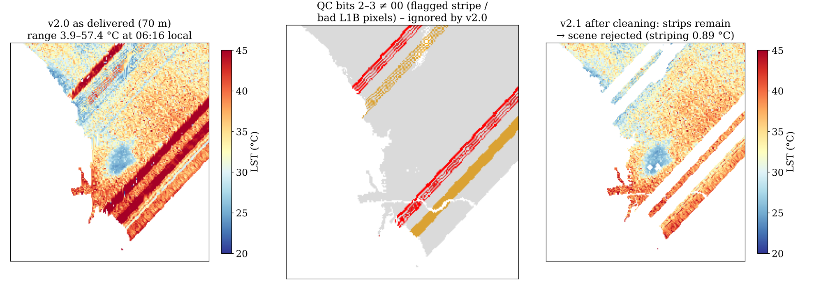
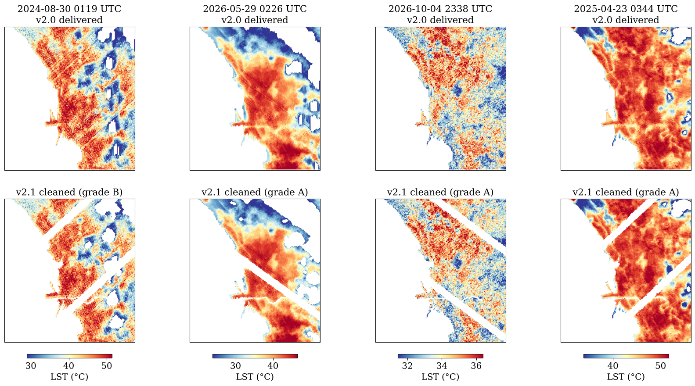
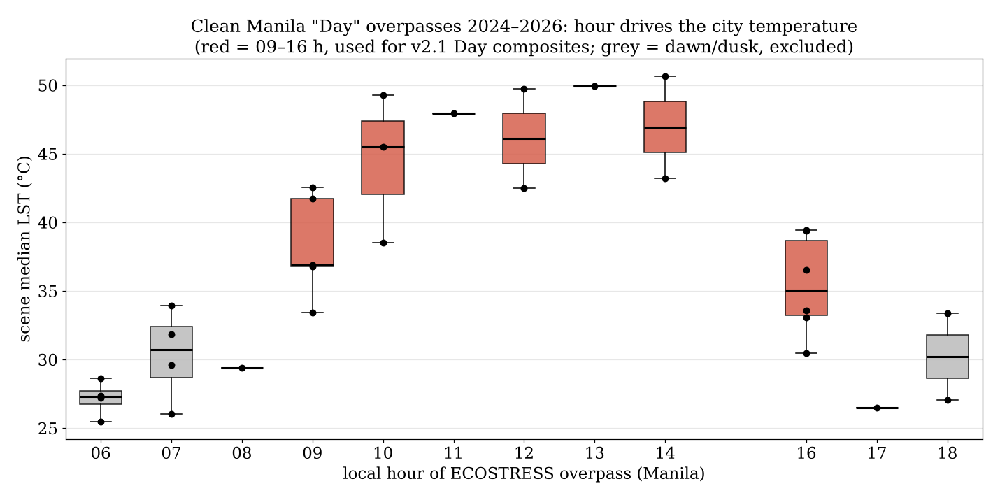
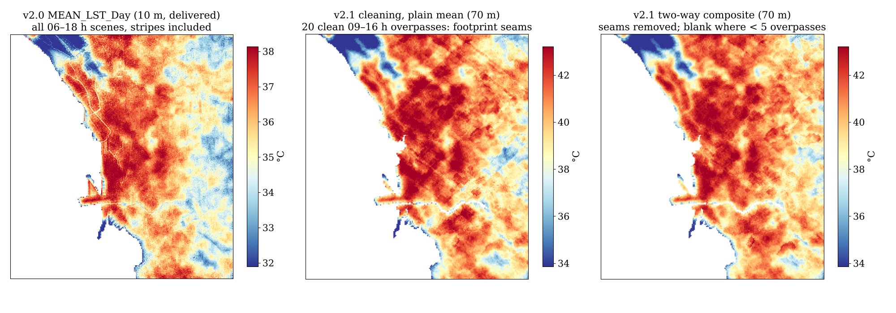

# Cleaning evidence - why v2.1 cleans ECOSTRESS the way it does

Audit of the 66 ECOSTRESS L2T_LSTE **Collection 2 (ECOv002)** granules over Manila,
2024-01 to 2026-10, run on the files in `notebooks/manila_6_18_ecostress_data/`.
All figures are reproducible from those files.

## 1. The stripes are flagged by NASA, and v2.0 kept them

ECOSTRESS QC is a bit field. Bits 0-1 (mandatory QA): 00 best, 01 nominal, 10 cloud,
11 not produced. Bits 2-3 (L1B data quality): 00 good, **01 missing-stripe pixel**,
11 missing/bad. v2.0 kept bits 0-1 < 2 and never read bits 2-3.

In the overpass in v2.0 singled out (2024-07-07 22:16 UTC, 06:16 local), the flagged pixels
sit **+10.6 °C** above clean pixels of the same scene; the delivered 70 m map ranged
3.9-57.4 °C at dawn. v2.1 removes bits 2-3 ≠ 00 plus a 2-pixel halo. Bits 0-1 = 01 is
kept: in humid 2026 scenes it covers up to ~90 % of the land and is not biased there.

## 2. The "cloud-shaped artefacts" were made by the v2.0 gap filler

v2.0 interpolated **down image columns** any NaN gap of ≤ 12 pixels, to repair the
swath-product fill codes −9998/−9997. The tiled product does not use those codes, its scan
lines run diagonally, and cloud holes, rivers and masked pixels are all NaN - so cloud
holes were filled with vertical streaks. v2.1 does not gap-fill ECOSTRESS at all.

## 3. Residual detector lines

After QC masking, faint line offsets remain along the scan direction. The direction is
measured per scene from the flagged lines (≈ 43-47° ascending, ≈ 126-127° descending).
Line medians of a local high-pass are subtracted where significant (z > 4).

| check | result |
|---|---|
| injected ±0.6 °C lines, periods 4/8/16 | residual 0.12-0.25 °C |
| same method at a wrong angle, synthetic | 0.000 °C removed |
| real scenes, wrong-angle control (42 scenes) | ≤ 0.1 °C removed (90th pct.) |

**Scan-block levelling was tested and rejected.** Across a 12-pixel gap, normal urban
contrast already differs by 2-5 °C, so whole-block steps cannot be separated from real
structure. Scenes where they are severe are rejected instead: 2024-07-07 needs a 0.89 °C
line correction, the next-worst scene 0.58 °C; the rejection threshold is 0.8 °C.

## 4. Grades

Of 66 granules: 7 do not overlap the area, 27 rejected (26 ECOSTRESS cloud > 20 % or
< 30 % clean land, 1 striping), **30 grade A, 2 grade B**. Every rejection is written to
`rejected_scenes_<area>_<mode>.csv` with its reason.

## 5. Time of day

Among clean "Day" overpasses, those at 09-16 h have a median city LST of 40.6 °C (n = 20);
dawn/dusk ones 28.0 °C (n = 12). Averaging both into one "mean daytime" layer makes the
result depend on which hours happened to be cloud-free. v2.1 Day composites use 09-16 h.

## 6. Composite seams

Overpasses cover different footprints at different hours (scene offsets −9.8 to +9.6 °C).
A plain per-pixel mean jumps wherever the set of covering scenes changes (middle). v2.1
fits LST(scene, pixel) = pixel effect + scene effect and maps the pixel effect (right);
where coverage is complete this equals the plain mean. The two right panels are 70 m
(ECOSTRESS only); the 10 m version is produced by the pipeline with Sentinel-2.
