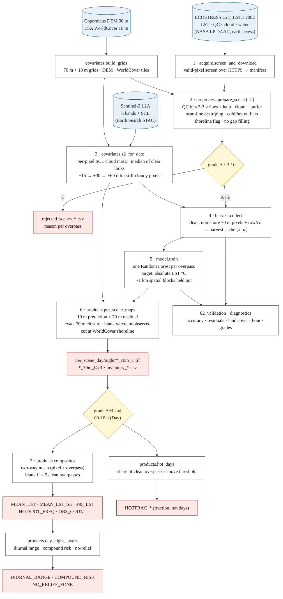

# High-Resolution Urban Heat Mapping - Tondo, Manila  (v2.1)

Downscaling ECOSTRESS land surface temperature (LST) from 70 m to 10 m, one map per
satellite overpass, for neighbourhood-scale heat-vulnerability assessment.

Geo-Humanitarian Research (Z_GIS), Paris Lodron University of Salzburg,
in partnership with Médecins Sans Frontières.

> **v2.1.** All temperatures are now in
> °C, there is no anomaly training, Sentinel-2 is used pixel by pixel with no scene
> cloud threshold, and the ECOSTRESS stripes are removed at the source (QC bits 2-3).
> The evidence is in [`CLEANING_EVIDENCE.md`](CLEANING_EVIDENCE.md); what changed is in
> [`CHANGELOG.md`](CHANGELOG.md). **Products in `products/` were written by v2.0 and must
> be regenerated** by re-running `01_pipeline` with `rebuild=True`.

---

## Data flow



Source: [`dataflow.mmd`](dataflow.mmd) (Mermaid).

## Quick start

### 1. Prerequisites (once)

| What | How |
|---|---|
| Python 3.11-3.13 | a clean virtual environment is strongly recommended -don't install picked up a conflicting `rasterio` from another environment |
| Packages | `python -m venv .venv` → activate → `pip install -r requirements.txt` → `python -m ipykernel install --user --name lst-v21` and pick the **lst-v21** kernel in Jupyter |
| NASA Earthdata account | free, https://urs.earthdata.nasa.gov - needed for ECOSTRESS downloads |
| Earthdata login | in the notebook: `earthaccess.login(persist=True)`. The first time it asks for user name and password and stores them in a `.netrc` file in your home folder; afterwards login is silent. Alternatively set environment variables `EARTHDATA_USERNAME` and `EARTHDATA_PASSWORD` before starting Jupyter. |
| Internet access | LP DAAC (ECOSTRESS), `earth-search.aws.element84.com` (Sentinel-2, Copernicus DEM), `esa-worldcover.s3.eu-central-1.amazonaws.com`. No other keys; `AWS_NO_SIGN_REQUEST=YES` is set automatically for the public buckets. |

### 2. Configure - in the notebook, not in `config.py`

Every setting is a keyword of the `Config` constructor, set in the notebook cell:

```python
from lstpipe import Config
cfg = Config.manila(mode="Day")                       # or mode="Night"
cfg = Config.for_city("vienna", (16.18, 48.12, 16.58, 48.33), "EPSG:32633",
                      "Europe/Vienna", mode="Day", lst_min_c=None)
```

Notebooks load `%autoreload`, so if you do edit `lstpipe/*.py` the change is picked up
without restarting the kernel.

### 3. Run

| Notebook | Purpose | Needs |
|---|---|---|
| `01_pipeline` | all per-scene maps, composites, hot layers, scene grades | Earthdata login; run once per mode |
| `01b_pipeline_stepwise` | the same, with intermediates exposed | for development |
| `02_validation` | accuracy, residuals, land cover, time of day, scene quality | `01` for that mode |
| `04_synthesis` | day–night layers, delivery inventory | `01` for **both** modes, same city |
| `05_new_dates_or_city` | running new dates or another city | Earthdata login |
| `legacy/03_transferability_v20` | retired - see below | - |

## Method (v2.1)

1. **Screen** each ECOSTRESS L2T_LSTE **Collection 2 (v002)** granule over HTTPS; download
   those that pass.
2. **Clean** (`preprocess.prepare_scene`), converting to °C immediately:
   QC mandatory bits 0-1 ∈ {best, nominal}; **QC bits 2-3 = 00** (removes the flagged
   stripe lines) plus a 2-pixel halo; cloud and cloud holes plus a 2-pixel buffer;
   detector-line offsets corrected along the scan direction measured from the stripe
   flags; undetected cloud removed as cold outliers and below a physical floor (15 °C in
   Manila); shoreline pixels flagged. **No gap filling.**
3. **Grade** every overpass: A ≥ 60 % of the land area clean, B ≥ 30 %, C rejected
   (ECOSTRESS cloud > 20 %, too little clean land, or residual striping > 0.8 °C). Each
   rejection is logged with its reason.
4. **Sentinel-2 per pixel**: no scene cloud-cover threshold; clouds, shadows and cirrus
   masked with the Scene Classification Layer; median of clear looks within ±15 days,
   cloudy pixels filled from ±30, then ±60 days.
5. **Train one Random Forest per overpass** on that overpass's clean 70 m pixels, target
   **absolute LST in °C** (NASA ARSET / data-mining-sharpener design). Accuracy on ~1 km
   spatial blocks held out within each scene.
6. **Map at 10 m**: the scene's model at 10 m plus its 70 m residual, iterated so each
   10 m block averages to the ECOSTRESS observation (median closure error < 0.01 °C in
   the offline test). Blank where ECOSTRESS did not observe; cut at the 10 m shoreline.
7. **Composite** grade A/B overpasses inside `product_hours` (Day: 09-16 h) with a two-way
   (pixel + overpass) model that removes footprint seams; blank where < 5 clean
   overpasses; observation-count and standard-error layers alongside.

## Accuracy

Accuracy figures are written by `01_pipeline` to `products/accuracy_by_scene_<area>_<mode>.csv`
and `models/<area>_<mode>_rf_meta.json`. **Quote per-scene MAE and RMSE in °C on held-out
spatial blocks and the median per-scene R².** Do not pool R² across overpasses: between-scene
level differences would inflate it. (The v2.0 table that stood here was computed on the
uncleaned data and the anomaly target and no longer applies.)

## Known limits

- **LST is not air temperature.** Radiometric surface readings; 50 °C on a midday roof is
  normal and says nothing directly about ambient conditions.
- **Hot-overpass layers are not a climate trend.** They are the share of clean overpasses
  above the threshold, and which overpasses were clean (and at what hour) varies by year.
- **Per-scene maps have gaps** where ECOSTRESS was cloudy or flagged (including the
  diagonal QC stripe lines). This is deliberate: a gap is better than an invented value.
  Composites fill them from other overpasses.
- **A faint scan-overlap texture** (perpendicular to the stripe lines, a few tenths of a
  degree) can be visible in low-contrast dawn/night scenes. It is not line-coherent, so it
  is not removed; it averages out in composites.
- **Scan-block level steps** between flagged stripe lines cannot be separated from real
  urban contrast; scenes where they are severe are rejected through grading rather than
  "repaired".
- **Skill scales with scene contrast.** On near-uniform scenes there is little to resolve.

## Transferability

Retired. With one model per overpass, a new city is simply run through `01_pipeline`
with `Config.for_city(...)`; there is no Manila model to transfer.

## Tests

```bash
python tests/test_v21.py                 # QC decoding, destriping, real granules, °C models, composites, S2 masking
python tests/test_integration_offline.py # end-to-end on the real Manila granules, S2 mocked
python tests/test_units.py               # components
python tests/test_session.py             # restore from disk gives identical metrics
python tests/test_paths.py               # output paths independent of working directory
python tests/test_isolation.py           # study areas cannot read each other's caches
```

## Troubleshooting

| Symptom | Cause and fix |
|---|---|
| `... was written by v2.0 (Kelvin, no pixel coordinates)` | Old harvest cache. Re-run `01_pipeline` with `rebuild=True`. |
| `no cached run for ... Day` in notebook 02 | `01_pipeline` has not completed for that city and mode, or the notebooks resolved different output roots. Every notebook prints `outputs -> ...`; the paths must match. |
| `AttributeError: 'NoneType' object has no attribute 'get_fsspec_session'` | Not authenticated. Run `earthaccess.login(persist=True)`. |
| `ModuleNotFoundError: lstpipe` or the wrong `rasterio` | The kernel is not the project environment. Select the `lst-v21` kernel (see Prerequisites). |
| `DownloadFailure ... 502` | Transient LP DAAC error. Downloads retry; re-run later, existing files are skipped. |
| `per_scene_maps needs the per-scene rasters` | The harvest came from cache. Pass `rebuild=True`, or use `run_pipeline`. |
| Many scenes rejected | See `rejected_scenes_<area>_<mode>.csv`. Mostly ECOSTRESS cloud > `max_cloud_cover`; relax it or `grade_b_frac` only with care. |
| Land cover unavailable | WorldCover tiles are now chosen from the bounding box; if it still fails, the bucket is unreachable from your network. |

## Documentation

| File | Contents |
|---|---|
| `docs/README.md` | this file |
| `docs/CLEANING_EVIDENCE.md` | the pixel-level audit behind v2.1, with figures |
| `docs/CHANGELOG.md` | v2.0 → v2.1 changes, each mapped|
| `docs/MODULES.md` | every module and its public interface |
| `docs/OUTPUTS.md` | catalogue of every file the pipeline writes |

## Acknowledgment

This repository contains code developed during my internship.

**Developer:** Kalid Hassen Yasin (MSc)
**Supervisor:** Dr. Getachew Workineh Gella
**Program:** Copernicus Master in Digital Earth
**Institution:** Paris Lodron University of Salzburg (PLUS)
**Research Group:** Geo-Humanitarian Research (Z_GIS)
